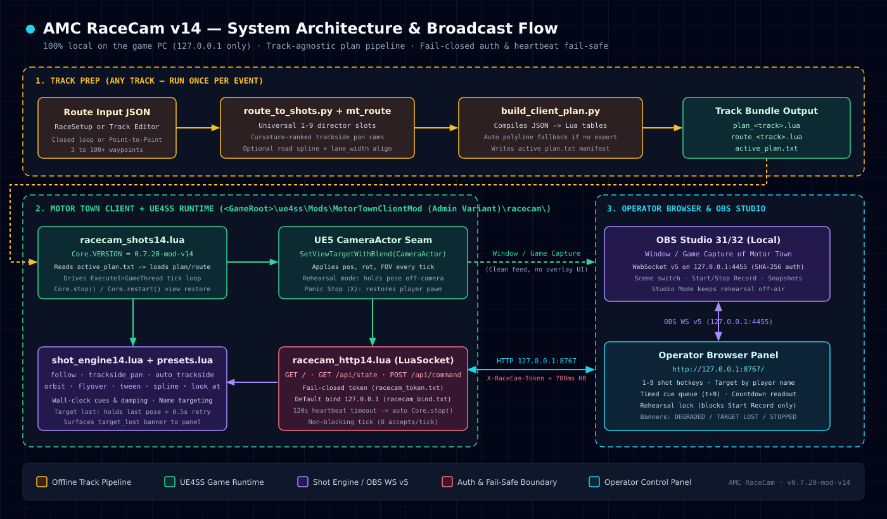
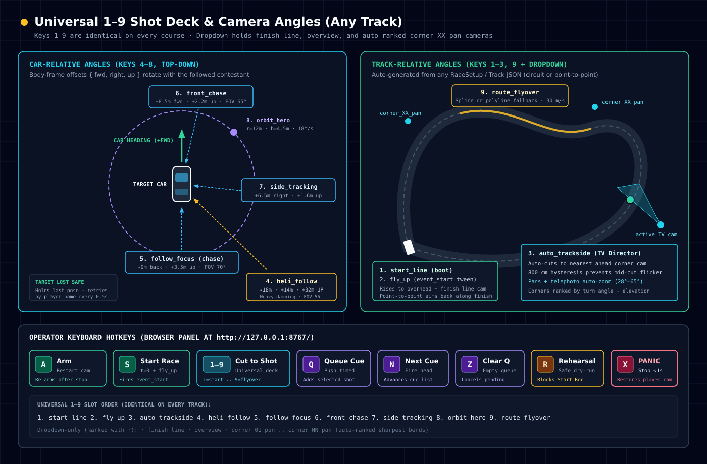

# AMC RaceCam — Operator & Installation Manual (v14)

**Target game build:** Motor Town `v0.7.20 [MOD]` with UE4SS
**Bundle version:** `0.7.20-mod-v14` (`racecam_shots14.lua`, `shot_engine14.lua`, `racecam_http14.lua`)
**Scope:** Local-only broadcast camera automation on the game PC (`127.0.0.1`).
**Ship vehicle:** AMC Admin Client Mod (**`MotorTownClientMod` — Admin Variant**). RaceCam is **not** included in the player-facing mod; it ships only in the admin full release zip and installs under the mod's own `racecam\` data folder.

---

## 1. What AMC RaceCam Is

AMC RaceCam drives Motor Town's world `CameraActor` directly from UE4SS Lua and exposes a browser control panel on `http://127.0.0.1:8767/`. Because the control UI lives in your browser (not inside the game window), OBS captures a clean broadcast feed directly from the Motor Town window — no overlays, no alt-tab choreography.

It is a component of the **AMC Admin Client Mod (`MotorTownClientMod` — Admin Variant)**. The player variant of the mod does not contain RaceCam; only the admin full release does.



### Key Components

- **Offline Track Pipeline (`route_to_shots.py`, `build_client_plan.py`, optional `mt_route/`)** — Converts **any** RaceSetup or track-editor route JSON into a Lua shot plan (`plan_<id>.lua`), a flyover route (`route_<id>.lua`), and an `active_plan.txt` pointer. Works for closed circuits, point-to-point rallies/hillclimbs, and 3-to-100+ waypoint tracks. Python 3.10+ is needed **only** for this step — never on the game PC.
- **Game Runtime (`racecam_shots14.lua`, `shot_engine14.lua`, `presets.lua`)** — Runs inside UE4SS on the game PC, reads `active_plan.txt`, manages smooth follow/pan/orbit/flyover/tween camera poses, tracks contestants by player name, and restores the player's own camera on stop.
- **Local HTTP Server & Panel (`racecam_http14.lua`)** — Serves the operator web panel on `127.0.0.1:8767` (fail-closed token auth + 120 s heartbeat fail-safe) and talks to OBS Studio via `obs-websocket` v5 (`127.0.0.1:4455`).

All runtime paths are resolved **dynamically** — via the `RACECAM_DIR` environment variable if set, otherwise relative to the game install (`ue4ss\Mods\MotorTownClientMod\racecam\`). Nothing is tied to a particular drive letter, so the mod works on any Windows PC and any Steam library location.

---

## 2. Prerequisites

| Requirement | Detail |
|---|---|
| Game | Motor Town `v0.7.20 [MOD]` on Steam (any library/drive) |
| Client mod | AMC Admin Client Mod full release zip (`MotorTownClientMod_vX.Y.Z_admin_full.zip`) — includes UE4SS and the LuaSocket runtime already; **no extra downloads needed** |
| OBS Studio | 31 or 32 with the built-in WebSocket server |
| Python 3.10+ | Only on the prep PC, and only if you build a custom track plan |

---

## 3. Step-by-Step Installation (Any Windows PC / Any Steam Drive)

### 3.1 Find your Motor Town folder in Steam

1. Open **Steam** → right-click **Motor Town** → **Manage** → **Browse local files**.
2. Explorer opens inside `<Motor Town>\MotorTown\`. Copy the path from the address bar — this is your **GameRoot**.
3. Inside GameRoot, confirm `Binaries\Win64\ue4ss\` exists (it ships inside the admin full release zip; if it doesn't, extract the zip first — see 3.2).

Typical shapes (the drive letter varies by machine — any Steam library location works):

```
<GameRoot>\Binaries\Win64\ue4ss\Mods\MotorTownClientMod\
<GameRoot>\Binaries\Win64\ue4ss\Mods\shared\
```

### 3.2 Extract the admin full release zip

1. Extract `MotorTownClientMod_vX.Y.Z_admin_full.zip` into `<GameRoot>\Binaries\Win64\` so that `ue4ss\`, `xinput1_3.dll`, and `Mods\MotorTownClientMod\` all land in place.
2. UE4SS and the LuaSocket runtime are **already included** in the zip — you do not need to download or install anything else.
3. Place the RaceCam runtime files into `<GameRoot>\Binaries\Win64\ue4ss\Mods\MotorTownClientMod\racecam\`:
   - `racecam_shots14.lua`, `racecam_http14.lua`, `shot_engine14.lua`, `presets.lua`
   - any `plan_*.lua`, `route_*.lua`, and `active_plan.txt` for your event
   - `socket.lua`, `mime.lua`, `ltn12.lua`, `socket\`, `mime\` go into `ue4ss\Mods\shared\`

**Automated alternative:** if you have the RaceCam repo checkout on the game PC, `install_client.ps1` does all of the above in one shot — it auto-detects the Motor Town install from the Windows Registry (HKCU `SteamPath` + `steamapps\libraryfolders.vdf`, checking `steamapps\common\Motor Town\MotorTown` on **every** configured library), and accepts `-GameRoot` as an override:

```powershell
powershell -ExecutionPolicy Bypass -File install_client.ps1
# or, explicitly:
powershell -ExecutionPolicy Bypass -File install_client.ps1 -GameRoot "E:\SteamLibrary\steamapps\common\Motor Town\MotorTown"
```

The default data directory is `<GameRoot>\Binaries\Win64\ue4ss\Mods\MotorTownClientMod\racecam` (override with `-DataDir` if needed). There are **no hardcoded drive-letter defaults** in the installer.

### 3.3 Create the local auth token

The HTTP panel refuses everything until a non-empty token file exists. Create it with this one-liner (PowerShell, on the game PC) — run it from `<GameRoot>\Binaries\Win64\ue4ss\Mods\MotorTownClientMod\`, or replace the path with your actual data dir. It writes 64 random hex characters directly to the token file and never prints the value:

```powershell
$b=[byte[]]::new(32);[Security.Cryptography.RandomNumberGenerator]::Create().GetBytes($b);
[IO.File]::WriteAllText("$(Get-Location)\racecam\racecam_token.txt",[BitConverter]::ToString($b).Replace('-','').ToLower())
```

Run it from `<GameRoot>\Binaries\Win64\ue4ss\Mods\MotorTownClientMod\`, or replace the path with your actual data dir. (The installer from 3.2 generates this automatically on first install.)

**The token never leaves the game PC: it is never printed, never committed to git, and never pasted into chat.** To paste it into the browser panel later, open the file in Notepad and copy it locally.

### 3.4 Optional configuration

- **`enableRaceCam` in `config.json`** — the admin variant's `config.json` can disable the RaceCam runtime entirely (`"enableRaceCam": false`) when you want the admin mod loaded without broadcast tooling.
- **`RACECAM_DIR` environment variable** — overrides where the runtime looks for plans, presets, token, and logs. Set it (System Properties → Environment Variables, or per-session `setx RACECAM_DIR "<path to your plans folder>"`) to point RaceCam at any folder on any drive — useful when you keep plans on a separate scratch drive. When unset, the runtime probes, in order:
  1. `.\ue4ss\Mods\MotorTownClientMod\racecam\`
  2. `..\ue4ss\Mods\MotorTownClientMod\racecam\`
  3. `.\racecam\`
- **`racecam_bind.txt`** — optional; if absent the HTTP server binds to `127.0.0.1` (recommended).

### 3.5 Configure OBS Studio

1. Add a **Window Capture** (or **Game Capture**) source pointing at the Motor Town window.
2. **Tools → WebSocket Server Settings**: enable the server on `127.0.0.1:4455` with **authentication enabled**; note the password (store it only locally — e.g. a plain file on the game PC, never in chat or git).
3. Enable **Studio Mode** (or Multiview on a second monitor) so rehearsal stays isolated from program output.
4. Launch OBS cleanly before events (no stale crash residue); a dirty OBS profile is the #1 cause of WebSocket connect failures.

---

## 4. Preparing Any Track

RaceCam is track-agnostic — closed circuits, point-to-point rally stages, hillclimbs, drift courses, and off-road routes all work. You need a RaceSetup or track-editor route JSON export (3–100+ waypoints).

> **No plan at all? The built-in default plan still works.** If no track plan loads, RaceCam falls back to the built-in follow/orbit shots, so you can broadcast with just keys `4`, `5`, `8` and targeting — no Python required.

### Standard build (any route)

```bash
python3 build_client_plan.py \
  --plan-id my_event \
  --route-json path/to/route.json \
  --out-dir "<Motor Town>/MotorTown/Binaries/Win64/ue4ss/Mods/MotorTownClientMod/racecam"
```

This generates:

- `plan_my_event.lua` — universal 1–9 director slots + `finish_line`, `overview`, and curvature-ranked `corner_XX_pan` cameras
- `route_my_event.lua` — automatic sampled waypoint polyline so `9. route_flyover` works even without road spline data
- `active_plan.txt` — set to `my_event` so the runtime loads it automatically on arm

### High-precision road-spline path (optional)

If you have an `mt_route` export:

```bash
python3 build_client_plan.py \
  --plan-id aewol \
  --route-json fixtures/aewol-rally-route.json \
  --route-export out/aewol_rally_route.json \
  --out-dir "<Motor Town>/MotorTown/Binaries/Win64/ue4ss/Mods/MotorTownClientMod/racecam"
```

With `--route-export`, trackside corner cameras align to the road spline tangent and `lane_width`, and `9. route_flyover` flies smoothly along the Hermite road centerline instead of the polyline fallback.

### Switching tracks between races

Either re-run `build_client_plan.py` for the next track, or edit `active_plan.txt` in the RaceCam data folder to contain the target `<plan_id>` (matching an existing `plan_<id>.lua`), then re-arm.

---

## 5. Arming & Using the Browser Panel

1. Launch Motor Town and join the server (spectator or parked car). **On load, RaceCam sits in standby and does NOT hijack your camera** — the engine is ready but your view stays untouched until you arm or pick a shot.
2. Arm the RaceCam bundle (via the admin mod's load path or your usual UEBridge eval of `racecam_shots14.lua`).
3. Open **`http://127.0.0.1:8767/`** in your browser (on the game PC).
4. Paste the token from `racecam_token.txt` into the **Token** field (saved in `localStorage` for future sessions).
5. Verify the status bar shows:
   - **Plan:** your active track ID
   - **Camera:** `ARMED`
   - **Heartbeat:** fresh (`< 2s`)
6. *(Optional OBS control)* Enter the OBS WebSocket password once and click **Connect**, then test **Refresh scenes → Go to scene → Preview**.

### Panel controls

- **`A` (Arm)** — restarts the camera loop after a manual stop or heartbeat fail-safe.
- **`X` (Panic Stop)** — instantly stops the loop and restores the player's own camera.
- **OBS Connect / Scenes / Preview / Record** — full broadcast control via OBS WebSocket v5, including **Start Record** / **Stop Record** (record start is blocked during rehearsal).

---

## 6. Universal 1–9 Shot Deck & Angles

Every track generates the **exact same 1–9 director layout** so your keyboard muscle memory never changes between events.



### Universal 1–9 Hotkey Slots

- **`1. start_line`** — Boot/grid shot framing the start line. Active immediately on arm.
- **`2. fly_up`** — Smooth 4 s `ease_in_out_cubic` intro tween rising from the start line to an overhead establishing shot. Fires automatically on **`S` (Start Race)**.
- **`3. auto_trackside`** — Automated TV-director mode. Continuously picks the nearest trackside camera ahead of the followed contestant (with 800 cm hysteresis so it never flickers mid-cut) and pans + telephoto-zooms as they pass.
- **`4. heli_follow`** — High aerial drone follow (`-18 m` back, `+14 m` right, `+32 m` up, heavy smoothing, `55°` FOV). Best for reading racing lines and multi-car battles.
- **`5. follow_focus`** — Tight rear chase (`-9 m` back, `+3.5 m` up, `70°` FOV). Classic hero follow shot.
- **`6. front_chase`** — Reverse battle cam (`+8.5 m` ahead of the car looking back, `65°` FOV). Best for overtakes and showing the chasing pack.
- **`7. side_tracking`** — Low parallel dolly (`+6.5 m` to the right, `+1.6 m` up, `68°` FOV). Great for drift, rally, and close-up speed.
- **`8. orbit_hero`** — Smooth 360° orbit (`12 m` radius, `4.5 m` up, `18°/s`) around the target contestant (or last look point if no target). Ideal for grid lineups and post-race podiums.
- **`9. route_flyover`** — Continuous `30 m/s` course flyover following the road spline (or polyline fallback). Ideal for pre-race track previews.

### Track-Specific Dropdown Shots (marked with `·`)

- **`· finish_line`** — Frames the finish line (aims across the line on closed circuits, or looks back along the incoming finish straight on point-to-point stages).
- **`· overview`** — High static establishing view over the course center.
- **`· corner_XX_pan`** — Up to 6 curvature- and elevation-ranked corner cameras. Each stays fixed on the outside of the bend, pans to track the followed contestant, and auto-zooms (`28°`–`65°` FOV). Falls back cleanly to a static corner frame if no contestant is selected.

---

## 7. Keyboard Hotkeys

Focus must be outside text inputs for single-key hotkeys to fire.

| Key | Action | Detail |
|---|---|---|
| `A` | Arm | Restart the camera loop (`Core.restart()`) after stop / fail-safe |
| `S` | Start Race | Sends the `start` signal (`t = 0`), triggers `2. fly_up`, starts timed cues |
| `1`–`9` | Cut to shot | Universal shot slots 1 through 9 |
| `Q` | Queue Cue | Adds the selected dropdown shot to the queue (optional `t+N` delay in the **At t+** box) |
| `N` | Next Cue | Fires the head of the cue queue immediately |
| `Z` | Clear Queue | Empties all pending queued cues |
| `R` | Rehearsal | Engine runs and logs without moving the live camera; blocks **Start Record**, allows **Stop Record** |
| `X` | Panic Stop | Stops everything, restores the player's own camera in ~1 s |

---

## 8. Contestant Targeting

- Use the **Target** dropdown (populated from live pawns in the session) or type a player name and click **Select**.
- Targeting matches by **player name first**, falling back to numeric pawn index only if no player has that name.
- If the followed player disconnects or respawns, RaceCam **holds the last camera pose**, displays a red **`TARGET LOST`** banner, and retries name lookup every `0.5 s` until they return (or you switch targets/shots).

---

## 9. Safety & Fail-Safe Behavior

- **Manual Panic Stop (`X`)** — Always works immediately, restoring the player's camera view in `< 1 s`.
- **Heartbeat Fail-Safe (120 s)** — The panel polls `/api/state` every `700 ms`. If the browser tab is closed or crashes for more than `120 s`, the Lua server automatically calls `Core.stop()`, restores the player's camera, and marks the session `DEGRADED`. When the panel reconnects, the **DEGRADED** banner stays visible until you press **`A` (Arm)**.
- **Fail-Closed Auth** — If `racecam_token.txt` is missing or empty, `/api/state` and `/api/command` refuse all requests (`HTTP 400`). The server binds to `127.0.0.1` only — no remote exposure.
- **Rehearsal Guard** — While `R` is on, the panel blocks `StartRecord` so dry-runs never overwrite or pollute recordings, while still allowing `StopRecord`.
- **Standby on launch** — the runtime never grabs the camera on load; nothing moves until you arm or cut to a shot.

---

## 10. Pre-Event Checklist

1. Run `build_client_plan.py` for today's course (or confirm `active_plan.txt` already matches).
2. Launch OBS cleanly and verify it captures the clean Motor Town window.
3. Launch Motor Town, join the server, and confirm the RaceCam runtime loaded in standby (your view untouched).
4. Arm and open `http://127.0.0.1:8767/`; paste the token; verify **Plan / Camera: ARMED / Heartbeat < 2s**.
5. Connect OBS in the panel → **Refresh scenes** → **Go to scene** → **Preview**.
6. Test keys `1`, `4`, `5`, `3`, `9`, and **`X` (Panic Stop)** → verify the view restores cleanly → press **`A` (Arm)** to confirm restart works.
7. Record a 5-second test clip, stop it, and confirm the file saved cleanly.

---

## 11. Troubleshooting

- **Panel shows `HTTP 400` or `unauthorized`** — Check that `racecam_token.txt` exists in the RaceCam data folder, is non-empty, and matches the token pasted into the panel.
- **Wrong track loaded** — Check `active_plan.txt` and ensure `plan_<id>.lua` exists in the data folder, then re-arm. Find the folder via the panel status line or the `RACECAM_DIR` value you set.
- **Camera never activates** — The runtime sits in standby by design; press **`A` (Arm)** or cut to a numbered shot.
- **`TARGET LOST` banner stuck** — Either wait for the player to respawn (auto-recovers every 0.5 s), select another player, or cut to a non-follow shot (`1`, `2`, `9`).
- **OBS won't connect** — Confirm OBS WebSocket v5 is enabled on `127.0.0.1:4455` with auth on, and re-enter the password from your local OBS notes.
- **`PRESETS` / `NOFILE` errors on arm** — A plan/presets file is missing from the data folder; re-run the installer or `build_client_plan.py` with the correct `--out-dir`.
- **Need diagnostic logs** — Production file logging is off by default. Set `_G.RACECAM_LOG = 1` in UEBridge only when debugging; logs then write into the resolved RaceCam data folder (`core.txt`, `shots.txt`, `http.txt`, `events.jsonl`).
